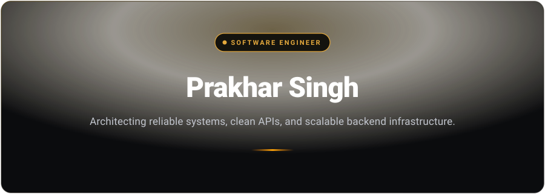
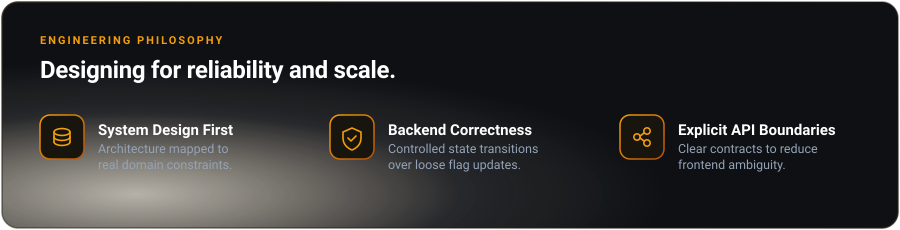
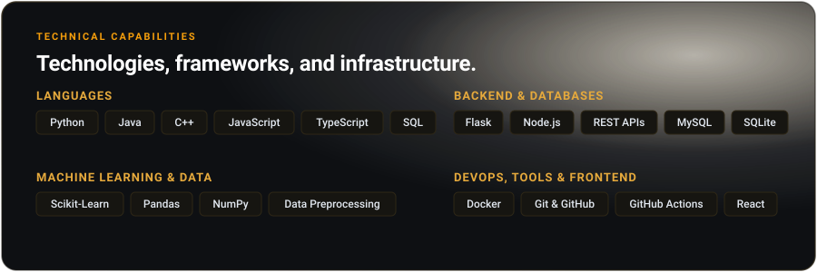

  <!-- 1. HERO BANNER CARD -->
  

    

  <!-- 2. SUB-HEADING -->
  

    
  

   

  <!-- 3. ACTION BUTTONS (Yellow Luxury Rectangular Buttons) -->
  

    
    &nbsp;
    
    &nbsp;
    
    &nbsp;
    
  

   

  <!-- 4. ABOUT ME (Side-by-side with Cat Coding in Glasses GIF) -->
  <table border="0" width="100%">
    <tr>
      <td width="64%" align="left" valign="top">
        

          
        

        

          Hey there! I'm <b>Prakhar Singh</b>, a Computer Science undergraduate at <b>Dr. A.P.J. Abdul Kalam Technical University (AKTU)</b> specializing in backend architecture, scalable systems, and clean API design.
        

        

          🎓 <b>Education:</b> B.Tech in Computer Science &amp; Engineering (CGPA: 7.1) 
          💼 <b>Seeking:</b> Software Developer, Java/Python Engineer &amp; Backend Roles 
          ⚡ <b>Active Stack:</b> Spring Boot, Flask, Java, Python, React, Vite, MySQL &amp; Docker 
          🧠 <b>Engineering Drive:</b> Mapping domain constraints to reliable system design &amp; explicit API contracts 
          📍 <b>Location:</b> Varanasi, Uttar Pradesh, India
        

      </td>
      <td width="36%" align="center" valign="middle">
        
      </td>
    </tr>
  </table>

   

  <!-- 5. ENGINEERING PHILOSOPHY CARD -->
  

    

  <!-- 6. TECHNICAL CAPABILITIES CARD -->
  

 

---

### 📂 Featured Systems & Engineering Projects

 

<!-- Project 1: Cross-Platform Music Player -->

  
<b>🎵 Spotify Clone &amp; Library</b> — <i>React, TypeScript, Tailwind CSS, CI/CD</i>

   
  <blockquote>High-performance client-side music application engineered with local metadata extraction, offline caching, and responsive audio playback.</blockquote>

  - **Architecture Highlights:**
    - Engineered continuous audio playback engine supporting shuffle, repeat, seeking, and crossfade transitions.
    - Built metadata and album-art parsing with indexed offline caching for instant local library navigation.
    - Set up automated unit and integration tests with CI workflows to ensure zero-regression versioned releases.
  - 🔗 **Links:** [Source Code](https://github.com/codesenpaiprakhar)

 

<!-- Project 2: Loan Approval System -->

  
<b>🏦 Automated Loan Approval Engine</b> — <i>Python, Flask, SQLite, REST APIs</i>

   
  <blockquote>Backend system automating financial credit scoring, applicant qualification, and persistent underwriting decisions.</blockquote>

  - **Architecture Highlights:**
    - Designed rule-based scoring engine evaluating applicant income, debt-to-income ratio, and credit history with granular approval/rejection audits.
    - Enforced database integrity and SQL injection protection using strictly parameterized SQLite queries.
    - Implemented full CRUD lifecycle with robust server-side request validation and structured HTTP responses.
  - 🔗 **Links:** [Source Code](https://github.com/codesenpaiprakhar)

 

<!-- Project 3: Personal Portfolio Website -->

  
<b>🌐 Live Metrics Portfolio Architecture</b> — <i>React.js, REST APIs, GitHub Actions, Netlify</i>

   
  <blockquote>Real-time developer showcase integrating live telemetry from external developer platforms with zero-downtime CI/CD.</blockquote>

  - **Architecture Highlights:**
    - Consumed GitHub and LeetCode REST APIs asynchronously to render dynamic profile stats and verified activity logs on load.
    - Configured continuous delivery pipelines via GitHub Actions directly to Netlify edge servers.
  - 🔗 **Links:** [Source Code](https://github.com/codesenpaiprakhar)

 

<!-- Project 4: ML Prediction Models -->

  
<b>🤖 Machine Learning Prediction Pipelines</b> — <i>Python, Scikit-Learn, Pandas, Flask</i>

   
  <blockquote>End-to-end predictive modeling workflows deployed through clean REST interfaces.</blockquote>

  - **Architecture Highlights:**
    - Trained predictive models for **Diabetes Risk** and **Property Price Prediction** with rigorous feature engineering and cross-validation.
    - Wrapped trained Scikit-learn estimators in lightweight Flask services for sub-second inference.
  - 🔗 **Links:** [Source Code](https://github.com/codesenpaiprakhar)

 

---

### 📊 GitHub Activity &amp; Live Telemetry

  <!-- Overall GitHub Stats (Amber/Dark custom palette) -->
  
  &nbsp;
  <!-- GitHub Streak Stats (Amber/Dark custom palette) -->
  

 

  <!-- Top Languages (Amber/Dark custom palette) -->
  

 

---

### 🐍 Contribution Activity

  <picture>
    <source media="(prefers-color-scheme: dark)" srcset="https://raw.githubusercontent.com/codesenpaiprakhar/codesenpaiprakhar/output/github-contribution-grid-snake-dark.svg">
    <source media="(prefers-color-scheme: light)" srcset="https://raw.githubusercontent.com/codesenpaiprakhar/codesenpaiprakhar/output/github-contribution-grid-snake.svg">
    
  </picture>

 

---

  Designed &amp; Architected by <a href="https://github.com/codesenpaiprakhar">Prakhar Singh</a> • Open to exciting engineering opportunities.

